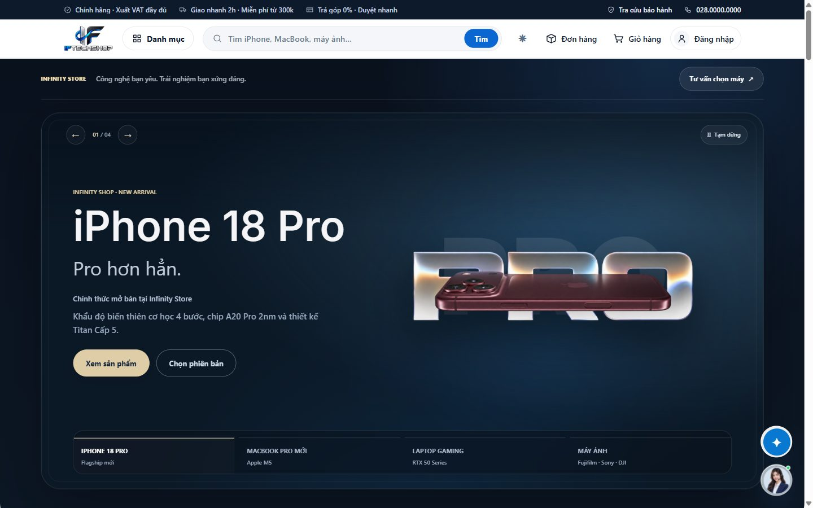
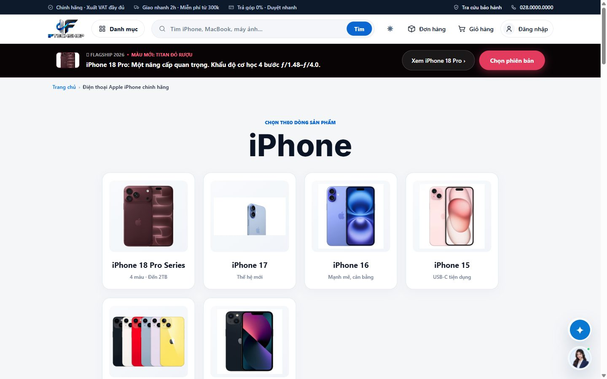
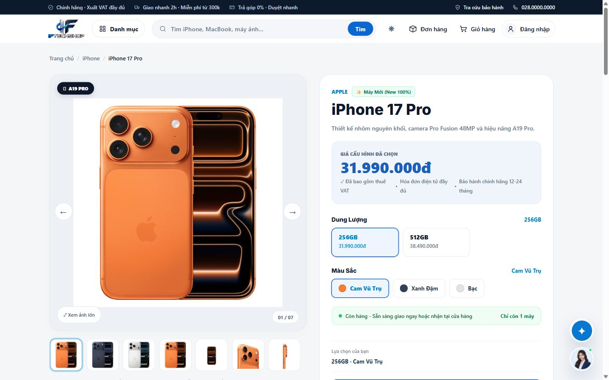
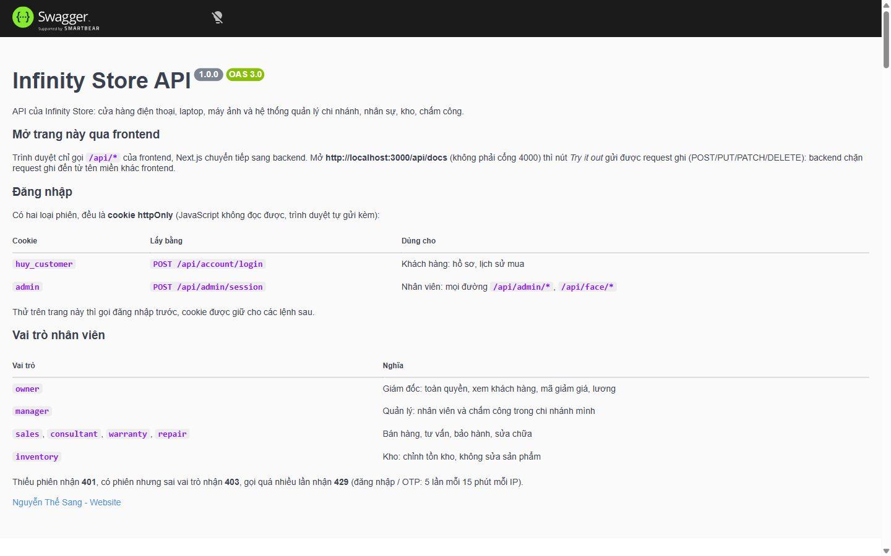

# Infinity Store

Website bán điện thoại, laptop, máy ảnh kèm **hệ thống quản lý nội bộ**: chi nhánh, nhân sự, chấm công bằng khuôn mặt,
kho, đơn hàng và chăm sóc khách hàng.

**Bản chạy thật:** https://infinityy-store.vercel.app · Tài liệu API: https://infinityy-store.vercel.app/api/docs

> Bản demo chưa bật các dịch vụ cần khóa riêng: **đăng ký tài khoản khách / quên mật khẩu** (cần Twilio để gửi mã OTP),
> **đăng nhập Google**, **tự xác nhận thanh toán qua Casso** (đơn vẫn được Giám đốc xác nhận tay) và
> **chấm công khuôn mặt** (máy chủ Python + TensorFlow không chạy được trên Vercel). Xem, tìm, giỏ hàng, đặt hàng,
> mã QR thanh toán và trang quản trị đều chạy.

> Tài liệu này mô tả **hiện trạng thật** của repo, không phải kế hoạch. Phần chưa làm nằm ở mục 14.
> Đổi cấu trúc thư mục thì sửa README trong cùng commit.



---

## Mục lục

| #   | Mục                                                   | Đọc khi                          |
| --- | ----------------------------------------------------- | -------------------------------- |
| 1   | [Tổng quan](#1-tổng-quan)                             | Lần đầu xem dự án                |
| 2   | [Công nghệ](#2-công-nghệ)                             | Lần đầu vào dự án                |
| 3   | [Chạy dự án](#3-chạy-dự-án)                           | Lần đầu vào dự án                |
| 4   | [Kiến trúc phân tầng](#4-kiến-trúc-phân-tầng)         | **Bắt buộc, trước khi code**     |
| 5   | [Cây thư mục](#5-cây-thư-mục)                         | Tìm chỗ đặt file                 |
| 6   | [Quy ước đặt tên](#6-quy-ước-đặt-tên)                 | Tạo file mới                     |
| 7   | [Nội dung tĩnh và dữ liệu](#7-nội-dung-tĩnh-và-dữ-liệu) | Viết chữ ra màn hình, sửa thông tin cửa hàng |
| 8   | [Luồng dữ liệu và API](#8-luồng-dữ-liệu-và-api)       | Nối frontend với backend         |
| 9   | [Phân quyền và bảo mật](#9-phân-quyền-và-bảo-mật)     | Thêm route quản trị              |
| 10  | [Kiểm thử](#10-kiểm-thử)                              | **Bắt buộc, trước khi commit**   |
| 11  | [Công thức](#11-công-thức)                            | Thêm endpoint / trang / file dùng chung |
| 12  | [Deploy](#12-deploy)                                  | Đưa lên Vercel hoặc tự host      |
| 13  | [Git](#13-git)                                        | **Bắt buộc, trước khi commit**   |
| 14  | [Nợ kỹ thuật](#14-nợ-kỹ-thuật)                        | Tìm việc để làm                  |

---

## 1. Tổng quan

### 1.1. Điểm nổi bật

- **Thanh toán tự xác nhận:** khách quét mã VietQR / MoMo; ngân hàng báo có qua webhook Casso, hệ thống tự khớp mã đơn
  và chuyển đơn sang "Đã thanh toán", không cần nhân viên đối soát tay.
- **Chấm công bằng khuôn mặt:** máy chủ Python (FastAPI + DeepFace) đăng ký và đối chiếu khuôn mặt nhân viên,
  kèm chấm công bằng passkey (WebAuthn). Một khuôn mặt chỉ gắn với một tài khoản, chống chấm công hộ.
- **Quản lý đơn hàng chặt:** trạng thái đơn đi theo quy trình (không nhảy cóc / quay ngược), đặt hàng trừ tồn kho
  của đúng biến thể, hủy / hoàn trả thì cộng lại kho và trả lượt voucher.
- **Giỏ hàng lưu theo tài khoản** trên máy chủ: đăng nhập máy nào cũng thấy cùng một giỏ, đăng xuất thì ẩn đi.
- **Phân quyền theo 7 vai trò**, quản lý chỉ thao tác nhân viên trong chi nhánh của mình (mục 9).
- **Tài liệu API bằng Swagger UI** (`/api/docs`, 108 endpoint), có test bảo đảm tài liệu luôn khớp với route thật.
- **Bảo mật:** giới hạn tần suất, chống CSRF, kiểm tra JSON, nhận dạng ảnh theo chữ ký nhị phân, mã hóa hồ sơ nhân sự.
  Chi tiết trong [SECURITY_AUDIT.md](SECURITY_AUDIT.md).
- **Kiểm thử:** backend 51 test gọi API thật trên PostgreSQL chạy trong bộ nhớ (PGlite), frontend 49 test.

### 1.2. Chức năng

| Khách hàng | Nội bộ cửa hàng |
| --- | --- |
| Danh mục, tìm kiếm, chi tiết sản phẩm theo dung lượng / màu | Sản phẩm, biến thể, ảnh, ẩn/hiện |
| Giỏ hàng lưu theo tài khoản, đặt hàng (kiểm tra tồn kho), mã giảm giá | Đơn hàng: trạng thái theo quy trình, thanh toán, giao chi nhánh, hóa đơn |
| Thanh toán VietQR, MoMo; trả góp; đặt trước | Mã giảm giá, danh sách khách hàng (chỉ Giám đốc) |
| Tài khoản: đăng nhập Google, xác minh email/SMS, quên mật khẩu | Nhân viên, chi nhánh, hồ sơ nhân sự (mã hóa), bảng lương |
| Lịch sử mua, hóa đơn, tra cứu bảo hành | Chấm công khuôn mặt / passkey, giao việc, camera |
| Ưu đãi sinh viên (gửi giấy tờ để duyệt) | Tồn kho theo chi nhánh, duyệt xác minh sinh viên |
| Chatbot gợi ý sản phẩm, chat trực tiếp với cửa hàng | Trả lời chat, báo cáo đơn hàng và lượt xem |

| Danh mục | Chi tiết sản phẩm |
| --- | --- |
|  |  |

---

## 2. Công nghệ

| Phần | Thư viện | Version | Dùng để làm gì |
| --- | --- | --- | --- |
| Frontend | Next.js (App Router) | 16.4 | Routing, SSR, server action, chuyển tiếp `/api/*` sang backend |
| | React | 19.2 | UI. **Mặc định là Server Component** |
| | Tailwind CSS | 4.2 | Lớp tiện ích; phần lớn giao diện viết CSS thường trong `src/styles/` |
| | TypeScript | 5.9 | `strict: true` ở cả frontend và backend |
| Backend | Express | 5.1 | REST API, middleware phân quyền và bảo mật |
| | Drizzle ORM + `pg` | 0.45 / 8.16 | Truy vấn PostgreSQL, migration trong `backend/drizzle/` |
| | PGlite | 0.3 | PostgreSQL chạy trong Node: chạy thử không cần cài Postgres, và CSDL cho test |
| | Multer | 2.4 | Nhận tệp tải lên (ảnh sản phẩm, avatar, tệp công việc) |
| | `@simplewebauthn/server` | 13.3 | Passkey chấm công |
| | `vietnam-qr-pay`, `qrcode` | 1.5 | Sinh mã VietQR / MoMo |
| | `swagger-ui-express` | 5.0 | Trang tài liệu `/api/docs` |
| | `tsx` | 4.20 | Chạy TypeScript trực tiếp (dev, test, script) |
| Máy chủ khuôn mặt | FastAPI + DeepFace | 0.141 / 0.0.100 | Đăng ký, đối chiếu khuôn mặt (model Facenet512) |

Alias import ở frontend: `@/*` trỏ về gốc `frontend/`, ví dụ `@/src/services/api`.

> ⚠️ Next.js 16 có breaking change so với các bản trước. Trước khi dùng một API lạ, đọc `node_modules/next/dist/docs/`
> (xem `frontend/AGENTS.md`).

---

## 3. Chạy dự án

```bash
# Backend (cổng 4000)
cd backend
cp .env.example .env          # rồi điền giá trị, xem bảng bên dưới
npm install
npm run db:migrate            # tạo bảng
npm run db:seed               # nạp sản phẩm mẫu, thông tin cửa hàng (backend/seed/) + tài khoản Giám đốc
npm run dev

# Frontend (cổng 3000)
cd frontend
cp .env.example .env.local
npm install
npm run dev
```

Mở **http://localhost:3000**. Trang quản trị: `/admin` (chưa đăng nhập thì chuyển sang `/admin-login`,
dùng `OWNER_USERNAME` / `OWNER_PASSWORD`).
Máy chủ khuôn mặt cài và chạy riêng: xem [python-ai/README.md](python-ai/README.md).

Biến môi trường backend (đủ danh sách trong `backend/.env.example`):

| Biến | Bắt buộc | Tác dụng |
| --- | --- | --- |
| `DATABASE_URL` | Có | PostgreSQL. Chạy thử không cần Postgres: `pglite:./.pglite` |
| `FRONTEND_URL` | Có | Địa chỉ frontend: chống CSRF, đăng nhập Google, passkey |
| `OWNER_USERNAME`, `OWNER_PASSWORD` | Có | Tài khoản Giám đốc do `npm run db:seed` tạo |
| `INTERNAL_API_SECRET` | Có ở production | Giống hệt bên frontend. Thiếu thì backend tính mọi khách chung một IP; production thiếu thì không khởi động |
| `HR_DATA_KEY` | Có nếu có hồ sơ nhân sự | Khóa mã hóa hồ sơ nhân sự. Đổi khóa là mất khả năng đọc hồ sơ cũ |
| `STORAGE_DRIVER`, `UPLOAD_DIR`, `BLOB_READ_WRITE_TOKEN` | Không | Lưu tệp: `local` (thư mục) hoặc `blob` (Vercel Blob) |
| `CASSO_WEBHOOK_SECRET` | Không | Bật tự xác nhận thanh toán qua webhook Casso |
| `GOOGLE_*`, `TWILIO_*` | Không | Đăng nhập Google, gửi mã OTP |
| `PASSKEY_RP_ID`, `PASSKEY_ORIGINS` | Không | Passkey chấm công; để trống thì lấy từ `FRONTEND_URL` |
| `FACE_API_URL`, `FACE_API_KEY`, `FACE_AUTOSTART`, `FACE_IDLE_MINUTES` | Không | Chấm công khuôn mặt; để trống là tạm tắt |

Biến môi trường frontend (`frontend/.env.example`): `BACKEND_URL` (mặc định `http://localhost:4000`),
`INTERNAL_API_SECRET` (giống backend), `SITE_URL` (Open Graph, sitemap).

---

## 4. Kiến trúc phân tầng

### 4.1. Sơ đồ

```
Trình duyệt
   │  chỉ gọi /api/* của chính frontend (cookie cùng tên miền, không cần CORS)
   ↓
┌──────────────────────────────────────────────────────────────────┐
│  frontend/  Next.js                                              │
│  app/            Routing: page, layout. CHỈ lắp ráp             │
│  src/components/ UI: features/{portal,admin} → layout → common   │
│  src/services/   Gọi backend từ phía máy chủ Next (api.ts)       │
│  next.config.ts  rewrites: /api/* → BACKEND_URL/api/*            │
└───────────────────────────────┬──────────────────────────────────┘
                                ↓  HTTP + cookie (+ x-internal-key khi gọi từ máy chủ Next)
┌──────────────────────────────────────────────────────────────────┐
│  backend/  Express                                               │
│  middlewares/   securityHeaders → rateLimit → sameOriginWrites   │
│                 → safeJsonBody → loadCustomer                    │
│  routes/        Đường dẫn + phân quyền (requireAdmin(...))       │
│  controllers/   Đọc request, gọi service, trả response           │
│  services/      Nghiệp vụ (đặt hàng, giá, sản phẩm, cài đặt...)  │
│  repositories/  Truy vấn Drizzle, chỉ tầng này chạm CSDL         │
└───────────────────────────────┬──────────────────────────────────┘
                                ↓
                PostgreSQL (Neon) · PGlite khi chạy thử / test
                Máy chủ khuôn mặt FastAPI (chỉ backend gọi, kèm X-API-Key)
```

### 4.2. Bốn quy tắc

**Quy tắc 1 — Phụ thuộc chỉ đi xuống.** `routes → controllers → services → repositories`. Controller không truy vấn
CSDL trực tiếp, repository không biết `Request`/`Response`. Ở frontend, `components/common` không import `features/`.

**Quy tắc 2 — Phân quyền khai ở route.** Mọi route quản trị gắn `requireAdmin(...)` ngay trong `routes/*.routes.ts`,
không kiểm vai trò rải rác trong controller. Riêng các ràng buộc theo chi nhánh (`canManageEmployee`) nằm trong controller
vì cần dữ liệu của bản ghi.

**Quy tắc 3 — Trình duyệt không gọi thẳng backend.** Luôn qua `/api/*` của frontend. Gọi từ server component / server action
thì dùng `src/services/api.ts` (tự gửi kèm cookie người xem và khóa nội bộ).

**Quy tắc 4 — Không tin dữ liệu từ trình duyệt.** Giá, tổng tiền, quyền đều tính lại ở backend. Ví dụ đặt hàng: frontend
gửi `productSlug` + cấu hình, backend tự tra giá trong CSDL (`services/order.service.ts`).

---

## 5. Cây thư mục

```
infinity-store/
├── backend/
│   ├── drizzle/                 # Migration SQL (0000_init, 0001_..., 0002_store_settings) + meta
│   ├── seed/                    # products.json, store-settings.json: dữ liệu mẫu cho db:seed
│   ├── scripts/                 # import-d1.ts (chuyển từ Cloudflare D1), legacy-catalog/ (dùng một lần)
│   └── src/
│       ├── app.ts / server.ts   # Lắp middleware + route / mở cổng
│       ├── config/env.ts        # Đọc biến môi trường, một chỗ duy nhất
│       ├── routes/              # *.routes.ts, gắn trong routes/index.ts
│       ├── controllers/         # *.controller.ts
│       ├── services/            # *.service.ts + chatbot/
│       ├── repositories/        # *.repository.ts
│       ├── middlewares/         # auth.ts (phiên, vai trò), security.ts, errors.ts
│       ├── db/                  # schema.ts, client.ts, migrate.ts, seed.ts, import-d1.ts
│       ├── docs/                # openapi.ts, paths.ts, schemas.ts: đặc tả Swagger
│       ├── utils/               # crypto, hr-crypto, http, installment, order-pricing
│       ├── constants/ types/    # payment, preorder-products / kiểu dùng chung
│       └── test/                # api.test.ts, docs.test.ts, test-db.ts (PGlite)
│
├── frontend/
│   ├── app/                     # Routing. CHỈ page, layout, metadata route
│   │   ├── (portal)/            # Trang khách: iphone/, san-pham/, gio-hang/, thanh-toan/, tai-khoan/...
│   │   ├── admin/ staff/ manager/   # Nội bộ
│   │   ├── admin-login/ quan-ly/ manger/   # Đăng nhập + đường dẫn cũ (chỉ chuyển hướng)
│   │   └── layout.tsx manifest.ts robots.ts sitemap.ts
│   ├── src/
│   │   ├── components/          # common/, layout/, features/{portal,admin}/<domain>/
│   │   ├── constants/           # shared/, portal/, admin/: MỌI chữ hiển thị (mục 7)
│   │   ├── services/            # api.ts, admin-auth.ts, customer-auth.ts, data.ts
│   │   ├── actions/             # Server action (form quản trị, đăng nhập)
│   │   ├── hooks/               # cart.tsx, store-settings.tsx
│   │   ├── lib/ types/          # Helper thuần, bản sao dùng chung với backend (mục 7.2)
│   │   └── styles/              # base/, storefront/, admin/
│   ├── public/                  # Ảnh sản phẩm, icon
│   └── tests/                   # *.test.mjs (node:test)
│
├── python-ai/                   # face_server.py, requirements.txt; data/ (vector khuôn mặt) bị .gitignore
├── docs/                        # database.md (thiết kế CSDL), screenshots/
└── SECURITY_AUDIT.md
```

Ba điểm dễ nhầm:

- **`app/manger/` không phải gõ sai cần sửa.** Đó là đường dẫn cũ còn được giữ để chuyển hướng sang `/manager`, link cũ không chết.
- **Thông tin cửa hàng không nằm trong code.** `backend/seed/store-settings.json` chỉ là dữ liệu khởi tạo (mục 7.3).
- **`backend/scripts/legacy-catalog/` chỉ chạy một lần** khi chuyển dữ liệu từ bản Cloudflare cũ (mục 12.3), không phải code chạy thường xuyên.

---

## 6. Quy ước đặt tên

| Loại | Quy ước | Ví dụ |
| --- | --- | --- |
| File backend | `<tên>.<tầng>.ts` (kebab) | `order.service.ts`, `admin.routes.ts`, `voucher.repository.ts` |
| File component | `PascalCase.tsx` | `StorefrontHeader.tsx`, `CartToast.tsx` |
| File constants frontend | kebab | `checkout.ts`, `preorder-page.ts` |
| Hằng số | `SCREAMING_SNAKE_CASE` | `OWNER_ONLY`, `BANK_TRANSFER_PREFIX` |
| Nhóm vai trò | Đặt tên theo việc được làm | `MANAGERS`, `CATALOG_EDITORS`, `INVENTORY_STAFF` |
| Khóa object, tên biến | Tiếng Anh | `accountNumber`, không phải `soTaiKhoan` |
| Đường dẫn trang khách | Slug tiếng Việt không dấu | `/gio-hang`, `/thanh-toan` (nằm trên URL, khách đọc) |
| Chú thích trong code | Tiếng Việt không dấu | `// Gia tinh lai o may chu, khong tin gia trinh duyet gui len` |

---

## 7. Nội dung tĩnh và dữ liệu

### 7.1. Chữ hiển thị nằm trong `frontend/src/constants/`

**Không viết chữ thẳng vào JSX.** Sửa câu chữ thì sửa trong constants, không sửa trong component.

| Loại nội dung | Khai ở đâu |
| --- | --- |
| Header, footer, vai trò, đường dẫn nội bộ, cấu hình site | `constants/shared/` |
| Trang khách (trang chủ, danh mục, thanh toán, tài khoản...) | `constants/portal/<trang>.ts` |
| Trang quản trị, menu, trường sản phẩm | `constants/admin/` |

### 7.2. Một dữ kiện chỉ có một nguồn

Một số file phải chạy ở cả hai phía nên tồn tại **hai bản giống hệt nhau**:

| Backend | Frontend |
| --- | --- |
| `src/types/index.ts` | `src/types/index.ts` |
| `src/utils/installment.ts` | `src/lib/installment.ts` |
| `src/utils/order-pricing.ts` | `src/lib/order-pricing.ts` |
| `src/constants/preorder-products.ts` | `src/constants/portal/preorder-products.ts` |
| `src/services/chatbot/advisor.ts`, `consult.ts` | `src/lib/chatbot/advisor.ts`, `consult.ts` |

Sửa bản này thì **chép sang bản kia**. Test `frontend/tests/shared-copies.test.mjs` báo lỗi nếu hai bản lệch nhau
(chỉ bỏ qua khác biệt ở dòng import kiểu). Đừng "gộp cho gọn" một bên: giá tính ở trình duyệt và ở máy chủ sẽ không còn khớp.

### 7.3. Thông tin cửa hàng nằm trong CSDL

Hotline, showroom, tài khoản nhận tiền, MoMo, bên bán trên hóa đơn lưu ở bảng cài đặt, sửa trong
**Quản trị > Cài đặt cửa hàng** (chỉ Giám đốc). `backend/seed/store-settings.json` chỉ được nạp **khi CSDL còn trống**.
Mã doanh nghiệp, hotline, địa chỉ trong file đó là giá trị demo.

---

## 8. Luồng dữ liệu và API

```
Trang khách / quản trị (frontend/app)
   → server component, server action    → src/services/api.ts  ─┐
   → component client (fetch "/api/...") → next.config.ts rewrite ┤
                                                                  ↓
                                        backend /api/... → route → controller → service → repository → PostgreSQL
```

- Lỗi từ backend trả `{ ok: false, message }` (tiếng Việt). `src/services/api.ts` đổi thành `ApiError` có `status`.
- Webhook Casso gọi thẳng backend `POST /api/payments/casso`, xác thực bằng header `secure-token`.

### 8.1. Swagger



Chạy backend + frontend rồi mở **http://localhost:3000/api/docs**. Mở qua frontend thì nút *Try it out* gửi được
request ghi; mở thẳng cổng 4000 chỉ thử được GET, vì backend chặn request ghi từ tên miền khác frontend.
Bản đặc tả thô: `/api/docs.json` (nạp vào Postman được).

Mỗi endpoint khai bằng **một dòng** trong `backend/src/docs/paths.ts` (phương thức, đường dẫn, quyền, tóm tắt, thân yêu cầu).
`backend/src/test/docs.test.ts` đọc route thật trong `routes/` và báo lỗi nếu có route chưa khai hoặc tài liệu ghi route không tồn tại.

---

## 9. Phân quyền và bảo mật

| Vai trò | Nghĩa |
| --- | --- |
| `owner` | Giám đốc: toàn quyền, xem khách hàng, mã giảm giá, lương, cài đặt cửa hàng |
| `manager` | Quản lý: nhân viên và chấm công trong chi nhánh mình |
| `sales`, `consultant`, `warranty`, `repair` | Bán hàng, tư vấn, bảo hành, sửa chữa |
| `inventory` | Kho: chỉnh tồn kho, không sửa sản phẩm |

Nhóm vai trò dùng lại khai trong `backend/src/middlewares/auth.ts`: `OWNER_ONLY`, `MANAGERS`, `INVENTORY_STAFF`,
`CATALOG_EDITORS`. Thiếu phiên trả **401**, sai vai trò trả **403**, gọi quá nhiều lần trả **429**.

Hai loại phiên đều là cookie `httpOnly`: `infinity_customer` cho khách, `admin` cho nhân viên.

Lớp bảo mật đang có, rủi ro còn lại và việc bắt buộc trước khi lên production: [SECURITY_AUDIT.md](SECURITY_AUDIT.md).

---

## 10. Kiểm thử

```bash
cd backend  && npm run typecheck && npm test      # 51 test
cd frontend && npm run typecheck && npm test && npm run lint && npm run build
```

| Bộ test | Kiểm gì |
| --- | --- |
| `backend/src/test/api.test.ts` | Gọi API thật qua `supertest` trên PGlite: danh mục, đặt hàng và giá tính ở máy chủ, quy trình trạng thái đơn, trừ / cộng lại tồn kho, giỏ hàng theo tài khoản, webhook Casso, voucher, tài khoản khách, giới hạn đăng nhập, chống CSRF, phân quyền theo vai trò / chi nhánh, kho, hồ sơ nhân sự mã hóa, bảng lương, chat, cài đặt cửa hàng |
| `backend/src/test/docs.test.ts` | Swagger khớp route thật; trang `/api/docs` mở được qua Next.js |
| `frontend/tests/shared-copies.test.mjs` | Các file dùng chung hai phía giống hệt nhau (mục 7.2) |
| `frontend/tests/*.test.mjs` khác | Trả góp, danh mục iPhone 18, đặt trước MacBook, danh sách sản phẩm quản trị |

**Chạy đủ các lệnh trên trước khi commit**, phải xanh hết.

---

## 11. Công thức

### 11.1. Thêm một endpoint

1. Truy vấn mới → `backend/src/repositories/<tên>.repository.ts`.
2. Nghiệp vụ → `services/<tên>.service.ts` (nếu chỉ đọc đơn giản thì controller gọi thẳng repository).
3. Controller → `controllers/<tên>.controller.ts`: đọc `req`, kiểm tra đầu vào, trả JSON.
4. Route → `routes/<tên>.routes.ts`, gắn nhóm quyền (`requireAdmin(...MANAGERS)`...). Router mới thì gắn trong `routes/index.ts`.
5. **Thêm một dòng vào `backend/src/docs/paths.ts`**, không thì `docs.test.ts` đỏ.
6. Thêm test vào `api.test.ts` cho trường hợp đúng và trường hợp bị chặn quyền.

### 11.2. Thêm một trang khách

1. Chữ hiển thị → `frontend/src/constants/portal/<trang>.ts`.
2. Component → `frontend/src/components/features/portal/<domain>/`.
3. Route → `frontend/app/(portal)/<duong-dan>/page.tsx`, lấy dữ liệu qua `src/services/`.
4. Thêm đường dẫn vào `app/sitemap.ts` nếu là trang công khai.

### 11.3. Sửa file dùng chung hai phía

Sửa một bản trong bảng mục 7.2, chép sang bản còn lại, chạy `cd frontend && npm test` để `shared-copies` xác nhận.

---

## 12. Deploy

### 12.1. Vercel

Bản đang chạy dùng hai project Vercel:

| Project | Thư mục | Tên miền | Tài nguyên |
| --- | --- | --- | --- |
| `infinity-store-api` | `backend/` | infinityy-store-api.vercel.app | Neon PostgreSQL (Singapore), Vercel Blob riêng tư (Singapore) |
| `infinity-store` | `frontend/` | infinityy-store.vercel.app | — |

```bash
cd backend  && npx vercel --prod --yes                 # deploy backend TRƯỚC (frontend gọi API mới)
cd frontend && npx vercel --prod --yes --archive=tgz   # ảnh trong public/ nhiều, gói một tệp cho ổn định
```

- `backend/vercel.json` khai `"framework": "express"`, `frontend/vercel.json` khai `"framework": "nextjs"`. Thiếu dòng này
  Vercel coi thư mục là web tĩnh: backend trả 404 mọi đường `/api` và **phơi tệp trong thư mục ra ngoài**.
- `backend/.vercelignore`, `frontend/.vercelignore` chặn tải lên `.env*`, CSDL thử `.pglite/`, `uploads/`, `.next/`. Đừng xóa.
- Biến môi trường đặt bằng `vercel env add <TEN> production`. Backend: `DATABASE_URL` (Neon tự thêm), `BLOB_READ_WRITE_TOKEN`
  (Blob tự thêm), `FRONTEND_URL`, `OWNER_USERNAME`, `OWNER_PASSWORD`, `HR_DATA_KEY`, `INTERNAL_API_SECRET`,
  `STORAGE_DRIVER=blob`, `FACE_AUTOSTART=false`. Frontend: `BACKEND_URL`, `INTERNAL_API_SECRET` (giống backend), `SITE_URL`.
- CSDL mới: chạy `db:migrate` rồi `db:seed` từ máy với `DATABASE_URL` của Neon (dùng `DATABASE_URL_UNPOOLED` cho migrate).
- Trang `/api/docs` lấy CSS/JS của Swagger UI từ jsDelivr (`SWAGGER_UI_CDN` trong `backend/src/app.ts`), vì hàm trên Vercel
  không đóng gói tệp tĩnh trong `node_modules`.

### 12.2. Tự host (không qua Vercel)

Frontend lấy IP người dùng từ `X-Real-IP` / `X-Forwarded-For` để backend giới hạn số lần đăng nhập. Proxy đứng trước frontend
(vd Nginx) phải **ghi đè** hai header này, nếu không người dùng tự đặt IP giả và lách được giới hạn đăng nhập.
Vercel đã tự ghi đè nên không cần làm gì thêm. Giữ máy chủ khuôn mặt sau backend, không công khai cổng 8001.

### 12.3. Chuyển dữ liệu từ bản Cloudflare D1 cũ

```bash
cd backend
npm run db:import-d1 -- <file .sqlite hoặc .sql> [--files-from <thư mục tệp tải từ R2>]
npx tsx --env-file=.env scripts/legacy-catalog/bake-catalog.ts                  # kiểm tra, chưa ghi
npx tsx --env-file=.env scripts/legacy-catalog/bake-catalog.ts --write --force  # ghi
npm run db:seed                                                                 # thêm thông tin cửa hàng nếu chưa có
```

Lệnh `bake-catalog` đưa nội dung sản phẩm trước đây viết cứng trong code (ảnh theo màu, thông số, thứ tự hiển thị) vào CSDL.
Lệch còn lại là cố ý: biến thể iPad xếp theo dung lượng tăng dần. Chạy lại nhiều lần không nhân đôi dữ liệu.
Cần đặt `HR_DATA_KEY` giống bản cũ để đọc hồ sơ nhân sự đã mã hóa.

---

## 13. Git

### 13.1. Quy trình

1. Làm trên nhánh riêng: `feature/<ten>` · `fix/<ten>` · `docs/<mo-ta>` · `chore/<mo-ta>`.
2. Chạy đủ lệnh ở mục 10, phải xanh hết.
3. Gộp vào `main` khi đã kiểm tra xong. `main` là bản công khai.

### 13.2. Commit

```
<type>(<phạm-vi>): <mô tả ngắn gọn>
```

| Type | Ý nghĩa |
| --- | --- |
| `feat` | Thêm tính năng |
| `fix` | Sửa lỗi |
| `docs` | Tài liệu |
| `refactor` | Tái cấu trúc, không đổi hành vi |
| `test` | Thêm / sửa test |
| `chore` | Cấu hình, cập nhật thư viện |

Ví dụ: `feat(face): gioi han tan suat cham cong khuon mat`

### 13.3. KHÔNG được làm

- ❌ Commit `.env`, `.env.local`, `python-ai/data/`, CSDL cục bộ (`.pglite`), tệp tải lên (`uploads/`)
- ❌ Đưa số tài khoản, số điện thoại, email của người khác vào dữ liệu mẫu hay test
- ❌ `git push --force` lên `main` khi chưa có lý do rõ ràng
- ❌ Sửa một bản file dùng chung mà không chép sang bản kia (mục 7.2)

---

## 14. Nợ kỹ thuật

Đánh dấu `[x]` khi xong, xóa khỏi danh sách ở lần cập nhật kế tiếp.

### P1 — Lưới an toàn

- [x] **CI**: `.github/workflows/ci.yml` chạy typecheck + test (backend), typecheck + test + lint + build (frontend)
  mỗi lần đẩy lên `main` và mỗi pull request.
- [x] **31 test frontend `test.skip`** đọc chữ trong code Cloudflare/D1 cũ: đã xóa (phần đó `api.test.ts` kiểm).
  Test ảnh sản phẩm viết lại theo `backend/seed/products.json`. Frontend còn 49 test, 0 bỏ qua.
- [x] **6 cảnh báo lint** trong `frontend/src/services/data.ts`: đã bỏ tham số không dùng, lint 0 cảnh báo.

### P2 — Bảo mật (chi tiết trong SECURITY_AUDIT.md)

- [x] Giỏ hàng lưu trên máy chủ (bảng `customer_carts`, migration `0004`, `GET/PUT /api/account/cart`). Máy chủ lỗi
  hoặc chưa chạy migration thì giỏ tự dùng bản trong trình duyệt, trang không hỏng.
- [x] Trạng thái đơn theo quy trình (`backend/src/constants/order-status.ts`), tồn kho trừ khi đặt / cộng lại khi hủy
  (`backend/src/repositories/stock.repository.ts`). Đơn đặt trước khi có trừ kho không được cộng thêm khi hủy.
- [x] Giới hạn đăng nhập / OTP đếm trong PostgreSQL (bảng `rate_limit_buckets`, migration `0003`): mọi máy chủ Vercel
  thấy cùng một con số. API thường vẫn đếm trong bộ nhớ từng máy chủ, đủ chặn spam.
- [x] Hash mật khẩu ghi phiên bản (`v2$600000$...`, mức OWASP). Hash cũ 120.000 vòng vẫn đăng nhập được và được băm lại
  ngay khi đăng nhập đúng.
- [x] CSP cơ bản cho mọi trang (`frontend/next.config.ts`): script/kết nối chỉ từ chính trang, chặn `object`, chặn nhúng iframe.
  Còn `'unsafe-inline'` cho script; muốn chặt hơn thì làm CSP theo nonce (mỗi trang phải render động).
- [ ] Chấm công khuôn mặt chưa kiểm tra người thật (liveness). Cần mô hình chống giả mạo hoặc camera có cảm biến chiều sâu,
  chưa sửa trong code được; hiện kết hợp đăng nhập nhân viên + passkey.

### P3 — Dọn dẹp

- [x] Cookie khách đổi tiền tố `huy_` → `infinity_`. Vẫn đọc tên cũ nên không ai bị đăng xuất; đăng nhập / đăng xuất
  thì xóa cookie tên cũ.
- [ ] `frontend/src/styles/storefront/` có 21 file CSS chồng lớp qua nhiều đợt đổi giao diện → gộp lại.
- [ ] Xóa `backend/scripts/legacy-catalog/` sau khi đã chuyển dữ liệu trên CSDL thật.
- [ ] Công cụ phát triển còn lỗ hổng (`drizzle-kit` kéo esbuild cũ, `braces`); không vào bản chạy thật.

### Đã cân nhắc và quyết định chưa làm

- **Gộp file dùng chung hai phía thành một package**: cần workspace npm và đổi cách build cả hai project; hiện dùng test
  `shared-copies` để giữ hai bản khớp nhau.
