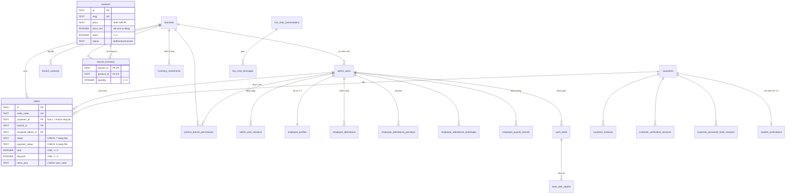

# Thiết kế cơ sở dữ liệu — Infinity Store

Hệ quản trị: **Cloudflare D1 (SQLite)** · ORM/lược đồ: **Drizzle** (`db/schema.ts`)

## 1. Tổng quan

| Nhóm | Bảng |
|---|---|
| Tổ chức | `branches`, `admin_users`, `admin_user_sessions`, `branch_cameras`, `camera_branch_permissions` |
| Nhân sự | `employee_profiles`, `employee_attendance`, `employee_attendance_passkeys`, `employee_attendance_challenges`, `employee_payroll_records`, `work_tasks`, `work_task_reports` |
| Sản phẩm & kho | `products`, `branch_inventory`, `inventory_movements`, `product_views` |
| Khách hàng | `customers`, `customer_sessions`, `customer_verification_sessions`, `customer_password_reset_sessions`, `student_verifications` |
| Bán hàng | `orders`, `bank_payment_events`, `vouchers` |
| Hỗ trợ | `live_chat_conversations`, `live_chat_messages` |
| Hệ thống | `api_rate_limits`, `schema_migrations` |

**Quy ước chung**

- Khóa chính: UUID kiểu `TEXT`. Thời gian: `INTEGER` (epoch, mili giây).
- Tiền: `INTEGER` tính bằng VND. Không dùng số thực, để tránh sai số làm tròn.
- Cờ đúng/sai: `INTEGER` 0/1, có `CHECK (x IN (0, 1))`.
- Tham chiếu tùy chọn (ví dụ khách vãng lai, đơn chưa phân chi nhánh) lưu `NULL`, không lưu chuỗi rỗng, để khóa ngoại hoạt động đúng.

## 2. Sơ đồ quan hệ (ERD)



## 3. Hành vi khóa ngoại

| Quan hệ | Khi xóa bản ghi cha | Lý do |
|---|---|---|
| Phiên, hồ sơ, chấm công, lương, passkey → `admin_users` / `customers` | `CASCADE` | Dữ liệu phụ thuộc, không còn ý nghĩa khi chủ thể bị xóa |
| `live_chat_messages` → `live_chat_conversations`, `work_task_reports` → `work_tasks` | `CASCADE` | Thành phần của bản ghi cha |
| `branch_inventory` → `branches`, `products` | `CASCADE` | Tồn kho của chi nhánh/sản phẩm đã xóa |
| `orders.customer_id / branch_id / assigned_admin_id` | `SET NULL` | Đơn hàng là chứng từ, phải được giữ lại |
| `admin_users.branch_id` | `SET NULL` | Nhân viên vẫn tồn tại khi đóng chi nhánh |
| `inventory_movements.branch_id` | `RESTRICT` | Không cho xóa chi nhánh còn lịch sử kho |

**Các cột cố ý không đặt khóa ngoại** (lựa chọn thiết kế, không phải thiếu sót):

- `orders.product_slug` và `orders.items_json` lưu "ảnh chụp" sản phẩm, giá, tên tại thời điểm đặt hàng. Hóa đơn không được thay đổi khi giá hoặc tên sản phẩm thay đổi về sau. Một đơn có nhiều dòng hàng được lưu thành mảng JSON, có `CHECK json_valid`.
- `orders.branch_name`, `orders.assigned_admin_name` và `work_tasks.assigned_name` cũng là ảnh chụp tên cho chứng từ, vì cùng lý do trên.
- `inventory_movements.product_id` là nhật ký kiểm toán: lịch sử phải còn ngay cả khi sản phẩm bị xóa.
- `product_views.product_slug` có thể là mã dòng máy (ví dụ `iphone-17`) chứ không phải một sản phẩm cụ thể.
- `work_tasks.created_by` có thể là tài khoản chủ cửa hàng, vốn không nằm trong `admin_users`.
- `bank_payment_events.order_code`: webhook ngân hàng có thể đến trước khi đơn được tạo. Hệ thống đối soát theo mã khi đơn được tạo sau.

## 4. Các lỗi đã phát hiện và cách sửa

| # | Lỗi | Hậu quả | Cách sửa |
|---|---|---|---|
| 1 | Mã đơn `order_code` do trình duyệt gửi lên, cột không có `UNIQUE` | Có 2 đơn trùng mã `HAC10DF43D7D`; webhook ngân hàng có thể đánh dấu "đã thanh toán" cho nhầm đơn | Máy chủ luôn tự sinh mã và thử lại khi trùng; thêm `UNIQUE`; migration cấp mã mới cho đơn trùng |
| 2 | Không có khóa ngoại nào | Có thể tồn tại dữ liệu mồ côi (phiên của khách đã xóa, tin nhắn không có hội thoại…) | 19 bảng được dựng lại kèm `FOREIGN KEY` và hành vi `ON DELETE` rõ ràng |
| 3 | Tiền trong `orders` lưu kiểu `TEXT` | Không thể `SUM`/so sánh chính xác; sai kiểu dữ liệu | Đổi 7 cột tiền sang `INTEGER` (VND) và thêm `CHECK >= 0` |
| 4 | Giá sản phẩm chỉ có dạng chữ ("Từ 25.990.000đ") | Không sắp xếp hoặc lọc theo giá bằng SQL được | Thêm cột sinh tự động `price_vnd INTEGER` và chỉ mục |
| 5 | Không có ràng buộc miền giá trị | Lưu được trạng thái tùy ý, tồn kho âm, voucher giảm 150%… | Thêm `CHECK` cho trạng thái, vai trò, số lượng, tiền, phần trăm, định dạng ngày |
| 6 | API đổi trạng thái đơn chấp nhận mọi chuỗi | Ghi được trạng thái rác vào DB | Kiểm tra danh sách hợp lệ ở tầng ứng dụng, kèm `CHECK` ở tầng DB |
| 7 | Trừ lượt voucher không nguyên tử | Khi nhiều người đặt cùng lúc, voucher bị dùng vượt `usage_limit` | `UPDATE … WHERE used_count < usage_limit` và kiểm tra số dòng bị ảnh hưởng; hoàn lượt nếu tạo đơn lỗi |
| 8 | Nhập/xuất kho theo kiểu đọc rồi ghi | Hai nhân viên thao tác cùng lúc làm mất một lần cập nhật | Compare-and-set (`WHERE quantity = giá trị đã đọc`), tự thử lại; nhật ký chỉ ghi khi cập nhật thành công |
| 9 | Mỗi lần khởi động chạy lại `UPDATE products SET condition = 'like-new' …` | Ghi đè tình trạng máy mà admin đã sửa tay | Bỏ; chỉ suy luận tình trạng khi nạp dữ liệu mẫu |
| 10 | `db/schema.ts` thiếu 5 bảng và hàng chục cột; thư mục migration lệch với DB thật | Tài liệu sai với thực tế; không dùng được để sinh migration | Viết lại `schema.ts` khớp 100% với DB, kèm quan hệ, CHECK và chỉ mục |
| 11 | Chỉ mục trùng lặp (cột `UNIQUE` lại có thêm một chỉ mục thường) | Tốn bộ nhớ, ghi chậm hơn | Xóa 6 chỉ mục thừa; thêm chỉ mục cho các cột khóa ngoại |
| 12 | `admin_users.role` mặc định là `'staff'`, không nằm trong danh sách vai trò | Bản ghi mới có thể mang vai trò không hợp lệ | Đổi mặc định thành `'sales'` và thêm `CHECK` |

## 5. Vận hành

```bash
npm run db:check     # kiểm tra: integrity_check, vi phạm khóa ngoại, mã đơn trùng
npm run db:upgrade   # áp dụng migration (tự sao lưu vào backups/); hãy dừng `npm run dev` trước

# Áp dụng trên Cloudflare D1 thật:
npx wrangler d1 execute <TEN_DB> --remote --file drizzle/0019_integrity_constraints.sql
```

Một cơ sở dữ liệu mới được tạo trực tiếp với cấu trúc đầy đủ: mỗi module `db/*.ts` chạy cùng câu lệnh DDL như trong migration. Bảng `schema_migrations` ghi lại các migration đã áp dụng.
